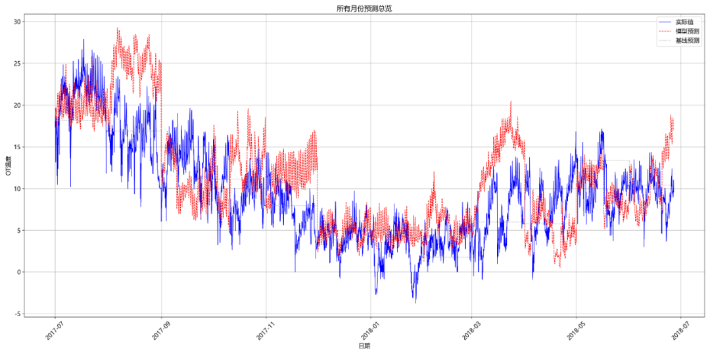
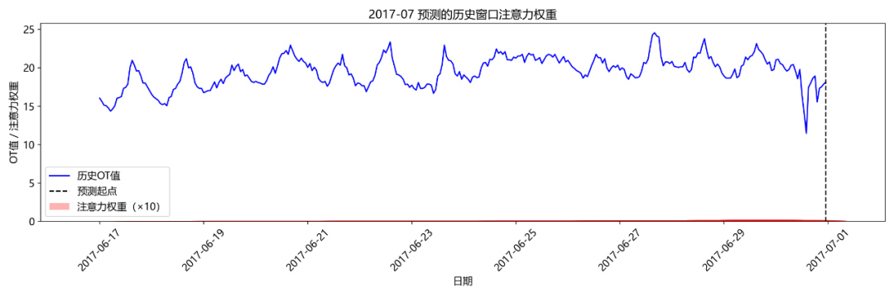
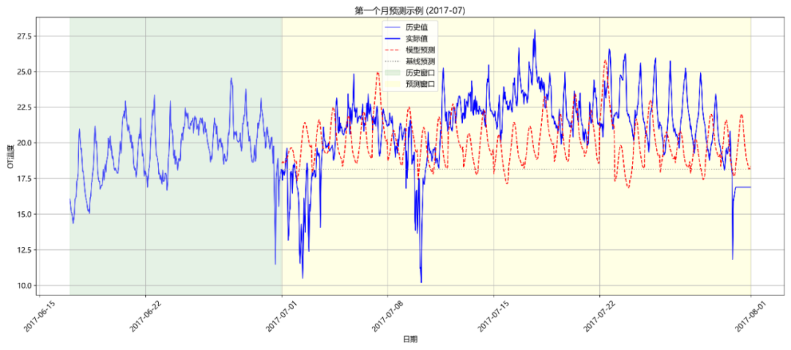

# Multi-temporal Time Series Prediction of Oil Temperature in Power Transformer Based on CNN-BiLSTM-Attention

>

Overall Project Preview

```
./cnn_bilstm_attention_xm/
├── dataset
│   └── ETTh1.csv
├── logs
│   └── log_train.txt
├── predict.py
├── prediction_result.csv
├── readme.md
├── requirements.txt
├── res_imgs
│   ├── all_months_prediction.png
│   ├── attention_weights_2017-07.png
│   └── first_month_prediction.png
├── saved_models
│   ├── attention_model_2018-06.h5
│   ├── cnn_bilstm_attention_2018-06.h5
│   ├── prediction_metrics.csv
│   └── scalers.json
├── tools
│   └── msyh.ttc
└── train.py
```

## 1. Problem Description

This project aims to address the task of multivariate time series prediction, implementing transformer oil temperature (OT) and related variables prediction based on the **Electric Power Transformers Data Set (ETTh1.csv)**. This dataset records hourly load indicators and oil temperature data from July 2016 to July 2018.

**Core Objective**: Utilize historical monitoring data to construct predictive models, achieving precise forecasting of the future state of transformers, thereby providing data support for equipment operation and maintenance.

**Specific Requirements**:

1.

1. **Data Processing**: Data preprocessing is conducted using Z-score normalization, with the normalization parameters calculated based on historical data from `2016.7-2017.6`.

1.

2. Prediction Granularity: Using data from the past 336 hours (14 days), predict future data for the next 24 hours (1 day).

1.

3. **Training Strategy**: Implement a **monthly rolling prediction** mechanism, starting from July 2017, retrain the model using all historical data up to the last month each month and predict the current month's data.

1.

4. **Effectiveness Evaluation**: Using Mean Squared Error (MSE) and Mean Absolute Error (MAE) as evaluation metrics, compared with the "Previous Value" baseline model.

## 2. Technology Implementation

1. Data Processing Flow

-

• **Data Loading and Cleaning**: Use `pandas` to load the ETTh1.csv data, convert the time format, and set it as an index, ensuring that the data frequency is hourly

-

• **Missing Values Handling**: Combine forward and backward imputation to handle missing values.

-

• **Standardization Process**: Calculate the mean and standard deviation of each feature based on the training data from `2016.7-2017.6`, perform Z-score normalization on the entire dataset, and save the normalized parameters for subsequent predictions.

### 2. Model Architecture

The project adopts the **CNN-BiLSTM-Attention** hybrid model architecture, which integrates the advantages of convolutional neural networks and recurrent neural networks:

-

• **CNN Feature Extraction Layer**: Through two convolutional (Conv1D) and pooling (MaxPooling1D) operations, local feature patterns are extracted, reducing the dimensionality of a 336-hour time series to 84 hours.

-

• **BiLSTM Layer**: Use a bidirectional LSTM network to capture the bidirectional dependencies of time series, equipped with a Dropout layer to prevent overfitting.

-

• **Attention Mechanism**: By customizing the Attention layer to focus on key time steps in the historical sequence, it enhances the model's attention to important information.

-

• **Output Layer**: Maps features to multivariate forecast results for the next 24 hours.

### 3. Training Mechanism

-

• **Monthly Rolling Training**: Starting from July 2017, retrain the model using all historical data up to the last month each month.

-

• **Data Splitting**: Use a 9:1 ratio to split the training set and validation set, employing EarlyStopping to prevent overfitting.

-

• **Model Saving**: Supports two saving strategies (save only the latest model or keep all monthly models), and also saves attention weight models for visualization analysis.

-

• **Training Parameters**: Batch size 128, learning rate 0.0005, maximum iterations 200, using Adam optimizer and MSE loss function

### 4. Forecasting Strategy

-

• **Rolling Prediction Mechanism**: Due to the model's single prediction per day, an autoregressive strategy is adopted. The forecast results from the previous 24 hours are used as part of the input for continuous prediction until the target period is covered.

-

• **Multi-step Prediction Implementation**: The `predict_rolling` function is used to implement continuous predictions of any duration, automatically handling the sliding update of the prediction window.

-

• **Result Reduction**: Convert the predicted results from the standardized scale to the original physical scale using the normalized parameters saved during the training phase.

### 5. Assessment and Visualization

-

• **Evaluation Indicators**: Calculate the MSE and MAE of each month's prediction results, and compare with the "Previous Value" baseline model.

-

• Visual content

-

• Monthly Attention Weight Distribution (showing the importance of each time step in the historical sequence)

-

• Prediction details for the first month (including historical window, prediction window, comparison of actual values and predicted values)

-

• Overall Periodic Prediction (shows the model performance for all prediction months)

-

• Prediction results comparison with historical data







## III. Code Structure

### train.py

-

• Data loading, cleaning and standardization processing

-

• Custom Attention Layer Implementation

-

• CNN-BiLSTM-Attention model construction

-

• Monthly rolling training and prediction logic

-

• Model Saving and Evaluation Indicator Computation

-

• Attention Weights and Visualization of Prediction Results

### predict.py

-

• Model and standardized parameter loading

-

• Predictive data preprocessing

-

• Implementation of rolling prediction function

-

• Inverse normalization transformation of prediction results

-

• Visualization and Saving of Prediction Results

## 4. Dependency Environment

```
pandas==1.5.3
numpy==1.23.5
scikit-learn==1.2.2
tensorflow==2.12.0
matplotlib==3.7.1
tqdm
```

## V. How to Run

1.

1. **Environmental Preparation**:

```
### Creating a Virtual Environment
conda create -n tf212 python=3.10
### Entering the Virtual Environment
conda activate tf212
### Install Specified Dependencies
pip install -r requirements.txt -i https://pypi.tuna.tsinghua.edu.cn/simple
```

1.

2. **Model Training**:

```
python train.py
```

The training process will automatically execute monthly rolling training, generating model files, evaluation metrics, and visualization images.

1.

3. **Predictive Execution**:

```
python predict.py
```

Load the latest model (or month-specific model) to predict future oil temperature based on historical data for a specified number of hours, and generate prediction results files and visualization images.

## VI. Output Explanation

-

• **Model Files**: Saved in the `saved_models` directory, including monthly models, attention models, and standardized parameters.

-

• **Evaluation Indicators**: Monthly MSE/MAE comparison table, saved as `prediction_metrics.csv`

-

• **Visualization Results**: Saved in `res_imgs` directory, including attention weights map, monthly prediction examples, and overall cycle prediction overview.

-

• **Prediction Results**: Generate `prediction_result.csv`, containing prediction time and corresponding OT temperature prediction values

The project, through the integration of various deep learning technologies and rigorous evaluation mechanisms, has achieved precise prediction of transformer oil temperature, providing effective support for intelligent operation and maintenance of power equipment.


## Payment

Here is a pay link on Stripe ( https://buy.stripe.com/3cs8yP7sY87d0vu9AB ). Please contact me lonlonago@foxmail.com after funding $89, and I will send you a complete data files , thank you!


